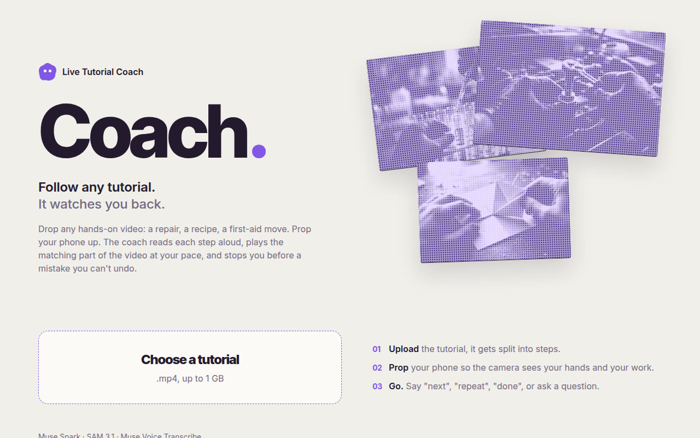
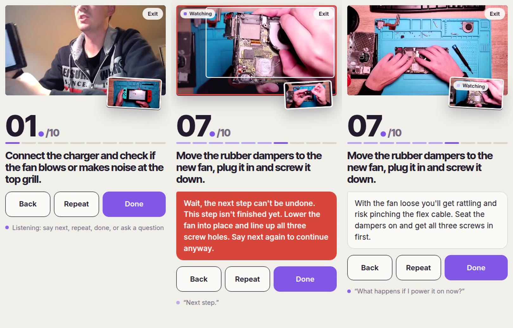

# Live Tutorial Coach

**Any video tutorial. Now it watches you back.**

Video tutorials only go one way: they never see your hands. You pause, rewind, squint, and find the mistake three steps too late, when it can no longer be undone.

Live Tutorial Coach turns any hands-on tutorial into a live coach. Upload an mp4, prop your phone up, and follow along hands-free: it reads each step aloud, plays just that part of the video, watches your work through the camera, points at what went wrong, and stops you before a step you can't undo.

Built in a week for the Meta Global AI Developer Hackathon (October 26 to November 4, 2026) with **Muse Spark 1.3**, **SAM 3.1** and **Muse Voice Transcribe 1.0**. Designed for Meta AI glasses; the phone is the stand-in.



## What it does

- **Splits any video into steps.** Muse Spark watches the whole tutorial with its narration and returns validated steps: instruction, expected result, common mistakes, a reference picture, and whether the step can be undone.
- **Coaches one step at a time.** It reads the step aloud, plays only that part of the video, then waits for you.
- **Watches your work.** Every 4 seconds, 3 camera frames are compared with the step's reference picture. About 4 s and $0.003 per check.
- **Points at the problem.** On a mistake it warns you out loud, and SAM 3.1 boxes the object on your camera view.
- **Stops you before the point of no return.** Before an irreversible step, saying "next" is not enough: the camera must have seen the current step finished. Otherwise the coach says why, boxes what is unfinished, and lets you continue only if you say next again.
- **Hands-free.** Say next, done, repeat or back, or just ask a question.
- **Built not to nag.** It speaks only when two checks agree, waits 15 s between warnings, treats hands in the way as normal work, and moves on by itself when the work matches the step.



It works on any tutorial with no setup or training. We tested it on a game console repair, a pasta recipe, a pressure bandage and an origami crane.

## How it works

1. **Prep, once per tutorial.** Muse Voice Transcribe turns the narration into timestamped text. Muse Spark watches the video with that narration and returns the steps as JSON validated with zod. ffmpeg grabs a reference picture per step.
2. **Live loop.** The phone streams camera frames and microphone audio over a WebSocket. Muse Spark judges each batch of frames against the step's reference picture. A small state machine decides whether to speak, warn, move on or stop you. SAM 3.1 boxes the object the warning is about.
3. **Voice.** The backend proxies Muse Voice Transcribe realtime. Short phrases are commands, longer ones are questions answered by Muse Spark. The phone speaks with the browser's speech synthesis and lowers the tutorial while it talks.

Full details: [technical documentation](docs/architecture.md).

## Run it

Needs Node 22+ and `ffmpeg` / `ffprobe` on the PATH, and a Meta Model API key.

```bash
npm install
echo "METAKEY=<your Meta Model API key>" > .env
```

Two terminals:

```bash
npm run dev -w server   # API + WebSocket on :8787
npm run dev -w web      # app on https://<your-ip>:5173 (self-signed, accept the warning once)
```

Open the app on your phone (same network) so the camera and microphone work over HTTPS. On the computer, `HTTP=1 npm run dev -w web` serves plain http on localhost.

## Tools

```bash
npm test -w server                                           # 18 state machine tests
npm run typecheck -w server                                  # TypeScript
npm run probe -w server -- a.jpg b.jpg c.jpg                 # latency and cost of a verdict and a SAM call
npm run live-test -w server -- <id> video.mp4 <step> 50 60   # replay video frames as the camera, print what the coach does
npm run reprep -w server -- <id>                             # re-run prep on an uploaded tutorial
```

## Documentation

| Document | Contents |
|---|---|
| [Technical documentation](docs/architecture.md) | components, prep pipeline, live loop, state machine, WebSocket protocol, HTTP API, data on disk, configuration |
| [Problems and solutions](docs/challenges.md) | everything that went wrong while building it and how we fixed it |
| [Roadmap](docs/roadmap.md) | known limitations, Meta AI glasses, other trades, product and technical next steps |
| [Demo video](docs/demo.md) | how the demo was recorded, what is live and what is staged, credits |
| [Feasibility probe](docs/feasibility.md) | first latency and cost measurements |

## Project structure

```
shared/   zod schemas and WebSocket message types shared by both sides
server/   Node backend: prep pipeline, judge, coach state machine, sessions, realtime voice
web/      React app for the phone
docs/     documentation
```

## Team

- Sandes ([Landry-16](https://github.com/Landry-16)): idea, architecture, backend, frontend, demo.
- Ashmita ([Ashmita1206](https://github.com/Ashmita1206)): AI reliability (occlusion-aware verdicts, progress memory, automatic step progression, tests), faster prep.

## Credits

Demo tutorials from Wikimedia Commons: "Nintendo Switch overheating repair" by Kiki Hobby Repair (CC BY 3.0), "Cooking with Laura: Homemade Pasta" by Northampton Community Television (CC BY 3.0), "Emergency bandage application uk" by Dctrzl (CC BY 2.0), "OrigamiCrane.ogv" (CC BY 3.0). Music in the demo video: "Inspired" by Kevin MacLeod (incompetech.com), CC BY 3.0.
