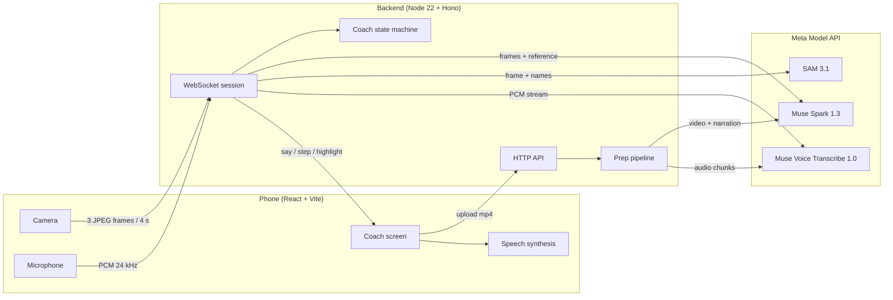
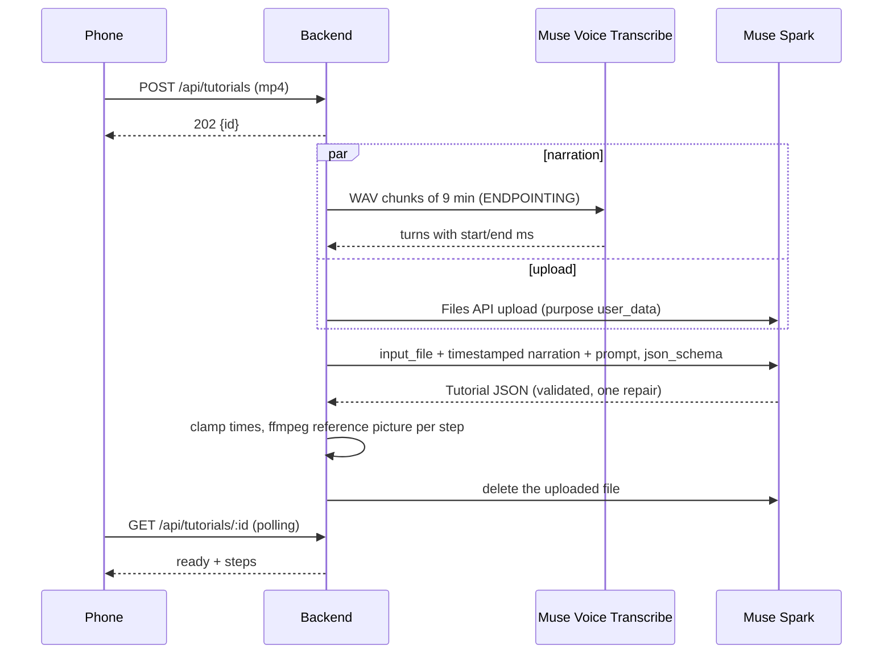
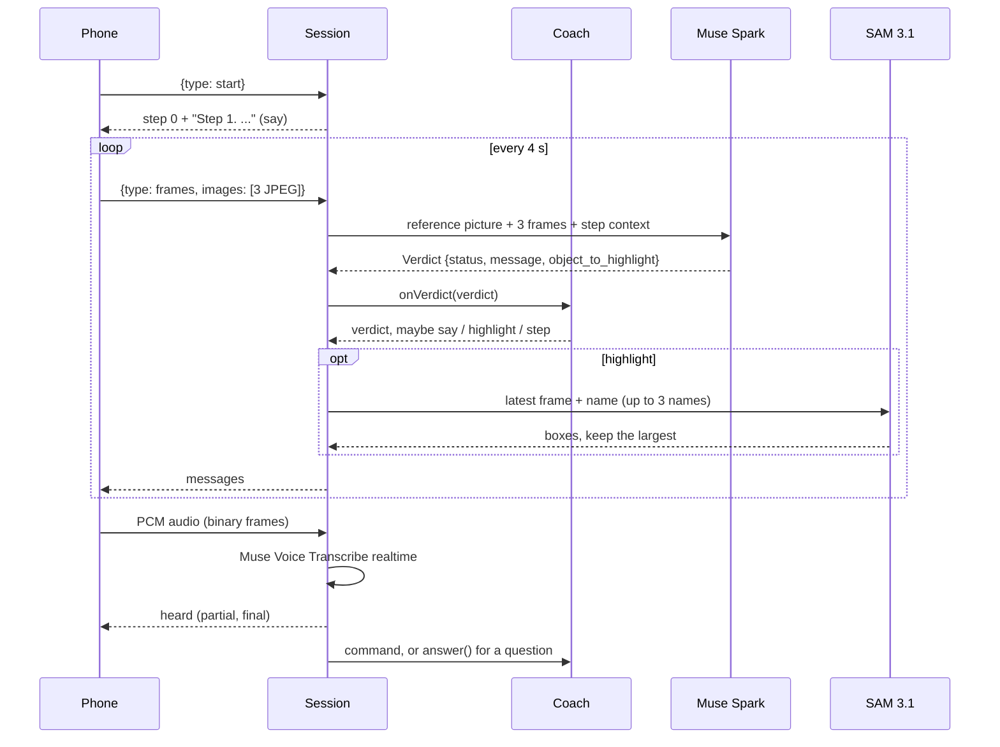
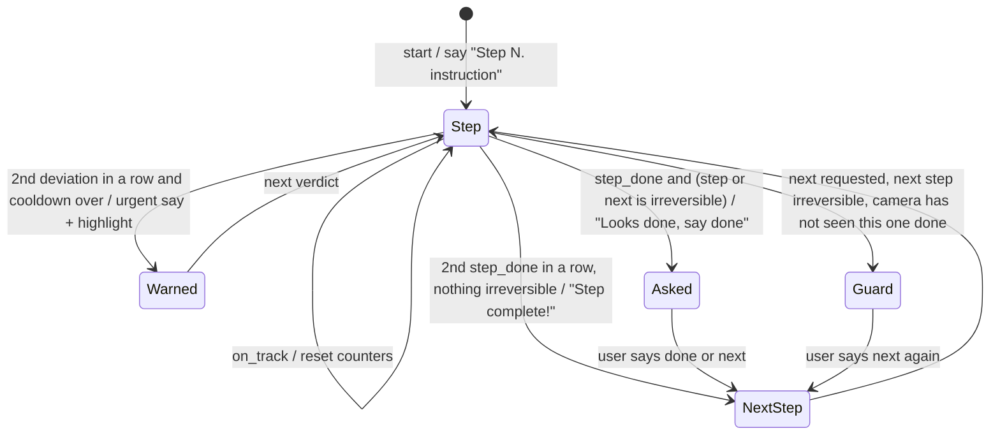

# Technical documentation

This document describes how Live Tutorial Coach is built: the components, the two pipelines (prep and live coaching), the protocol between the phone and the backend, the coaching state machine, the data on disk, and the tools used to test and tune it.

## Overview



| Part | Tech | Where |
|---|---|---|
| Frontend | React 19, Vite 8, TypeScript, plain CSS | `web/` |
| Backend | Node 22, TypeScript run by tsx, Hono, `@hono/node-ws`, `ws` | `server/` |
| Shared contracts | zod v4 schemas and message types | `shared/contracts.ts` |
| Models | Meta Model API through the `openai` SDK (OpenAI-compatible Responses API, base URL `https://api.meta.ai/v1`) | `server/src/meta.ts` |
| Media | ffmpeg and ffprobe on the PATH | prep pipeline |

The API key never leaves the backend. The phone talks only to our server, which proxies every model call, including realtime speech recognition.

## Repository layout

```
shared/contracts.ts      zod schemas (Step, Tutorial, Verdict) and the WebSocket message types
server/src/index.ts      HTTP routes, static media, WebSocket upgrade
server/src/prep.ts       prep pipeline: narration, steps, reference pictures
server/src/judge.ts      Muse Spark verdicts, SAM boxes, spoken answers
server/src/coach.ts      coaching state machine (pure, no I/O)
server/src/session.ts    one live session per phone: frames, voice, commands
server/src/asr.ts        realtime transcription proxy
server/src/llm.ts        structured output helper with one repair attempt
server/src/store.ts      tutorial status in memory, steps.json on disk
server/src/coach.test.ts state machine tests (node:test)
server/scripts/          probe, live-test, reprep, asr-test
web/src/                 App, Upload, Overview, Coach, Finished, media helpers, styles
data/<id>/               one folder per uploaded tutorial (gitignored)
```

## Prep pipeline (once per tutorial)

`POST /api/tutorials` stores the mp4 in `data/<id>/tutorial.mp4`, answers `202 { id }` at once and runs `prepare()` in the background. The phone polls `GET /api/tutorials/:id` and shows the current stage.



1. **Narration.** ffprobe checks for an audio stream. ffmpeg extracts 24 kHz mono WAV in 540 s chunks (the file endpoint accepts at most 10 minutes per request). Each chunk goes to `POST /v1/asr/transcribe` in `ENDPOINTING` mode, which returns turns with `startMs` and `endMs`. The turns are cached in `narration.json`, so re-running prep skips this step. Silent videos skip it entirely.
2. **Upload.** The video is uploaded through the Files API in parallel with transcription. Muse Spark needs a file: a YouTube URL is rejected.
3. **Steps.** Muse Spark receives the video as `input_file` plus the narration as `[start - end] text` lines and returns a `Tutorial` that matches `TutorialSchema`: for each step, `start_s` and `end_s`, an imperative `instruction`, an `expected_end_state` visible on camera, `reference_s` (the moment the result is best visible in close-up, not the presenter's face), `irreversible`, `timer_s`, `quantities` and 1 to 3 `common_mistakes`. Reasoning effort is `low`.
4. **Validation.** `askJson()` sends the zod schema as `text.format: json_schema` and parses the answer with zod. On failure it sends the error back once and asks again.
5. **Clean-up.** Steps are sorted, times are clamped to the video, and a `reference_s` outside its step falls back to half a second before the end.
6. **Reference pictures.** ffmpeg grabs one 640 px JPEG per step at `reference_s` into `ref/<step>.jpg`.
7. **Files.** `steps.json` and `narration.json` are written, the uploaded file is deleted from the Files API, and the status becomes `ready`.

`irreversible` is defined as "a mistake made at this step cannot be fixed afterwards": adding an ingredient to a mix, cutting to size, gluing, a sharp crease that will show, powering electronics on with a part missing or a connector loose, forcing a fragile part. Most steps are false.

Measured: about 1 minute for a 5 minute video, a little over 4 minutes for a 20 minute repair video.

## Live loop

The coaching screen opens a WebSocket to `/ws/<id>`. The backend creates a `Session` with a `Coach` for the tutorial.



### Camera

`web/src/media.ts` opens the back camera (`facingMode: environment`). Every 4 seconds the phone grabs 3 frames 500 ms apart, resized to 640 px wide, JPEG quality 0.7, and sends them as data URLs. While a check is running the backend drops new frames, so checks never pile up. If the user changed step while a check was running, its result is discarded.

### Verdict

`checkStep()` sends Muse Spark the step's reference picture first, then the camera frames oldest first, with the current step, its expected result, its common mistakes, whether the next step is irreversible, what the coach already said, and recent progress notes. Reasoning effort is `minimal`. The answer must match `VerdictSchema`:

| status | meaning |
|---|---|
| `on_track` | working on this step, nothing wrong yet; normal hand movement is never a mistake |
| `deviation` | a clear mistake: wrong action or amount, a result this step would not produce, or skipping ahead (an earlier step's result is missing or undone) |
| `step_done` | the result matches the expected end state |
| `unsure` | the work cannot be seen |

`message` is one spoken sentence of at most 20 words. `object_to_highlight` is up to 3 names separated by `|`: the specific part, the larger thing it belongs to as it looks right now, then its material, for example `fan | circuit board | metal`.

`cleanVerdict()` turns a deviation that is really about hands in the way into `unsure`, so occlusion never counts as a mistake.

Measured: about 4 s per verdict (2.3 to 8 s), about $0.003 per check.

### Highlight

When the coach decides to warn, it emits a `highlight` with the names. `Session.boxes()` tries each name with SAM 3.1 on the latest frame. SAM answers with one box per instance (`<|box;x1=..;y1=..;x2=..;y2=..;w=..;h=..|>`); we keep the largest, and a multi-word name that finds nothing is retried with its last word. The first name that finds something wins and becomes the label. The phone draws the box in percentages over the camera view and dims the rest for 8 seconds. About 1.2 s per SAM call.

### Voice

The phone captures the microphone with an AudioWorklet at 24 kHz, converts it to 16-bit PCM and sends 80 ms chunks as binary WebSocket frames. While the coach is speaking it sends silence of the same length instead, so the coach does not hear itself and the stream stays in real time.

`AsrStream` opens `wss://api.meta.ai/v1/asr/realtime` lazily on the first chunk, with `audioEncoding: PCM_24KHZ`, `mode: ENDPOINTING` and `partialMode: CUMULATIVE`. Partial transcripts go to the phone as `heard`. On `speechComplete`:

- an utterance of at most 4 words that contains next, skip, done, finished, ready, repeat, again, back or previous (and their French versions) is a **command**;
- anything longer is a **question**: `answer()` asks Muse Spark (effort `low`) with the whole tutorial, the current step and what the coach last said, for at most two short spoken sentences.

The phone speaks with the browser's `speechSynthesis`. Urgent lines interrupt, others queue, and the tutorial player's volume drops to 15 percent while the coach talks.

### Tutorial player

The phone plays only the current step's segment of the original video (`start_s` to `end_s`), pauses at the end and shows "Your turn, watch again". On a highlight, the camera view becomes the main view and the player moves to a small inset.

## Coaching state machine

`server/src/coach.ts` is pure: it takes verdicts and commands and returns messages, with no I/O. That makes it easy to test.

| Rule | Value |
|---|---|
| Deviations in a row before speaking | 2 |
| Minimum time between two spoken warnings | 15 s |
| `step_done` verdicts in a row before moving on by itself | 2 |
| Auto-advance | only when neither this step nor the next is irreversible |
| `unsure` verdicts before "keep the work in view" | 4 |
| Progress notes kept per step | 5 |



**The irreversible guard.** When the user says "next" or "done" and the next step is irreversible, the coach checks the last verdict. If it was not `step_done`, it answers instead of moving on: "Wait, the next step can't be undone." followed by the reason (the mistake, "This step isn't finished yet", or "I can't see your work to check it"), "Say next again to continue anyway." It also highlights what the last verdict named, and SAM boxes it on the latest frame. A second "next" goes through: the user stays in charge.

## WebSocket protocol

Phone to backend (`ClientMsg`):

| Message | Meaning |
|---|---|
| `{ type: "start" }` | begin at step 1 |
| `{ type: "frames", images: string[] }` | 3 JPEG data URLs |
| `{ type: "command", command: "next" \| "back" \| "repeat" \| "done" }` | on-screen buttons |
| binary frame | microphone PCM, 16-bit LE, mono, 24 kHz |

Backend to phone (`ServerMsg`):

| Message | Meaning |
|---|---|
| `{ type: "step", index, step }` | enter a step: the phone seeks the player |
| `{ type: "say", text, urgent }` | speak this; urgent interrupts and counts as a save |
| `{ type: "highlight", label, box }` | draw the box (pixel coordinates with the frame's `w` and `h`) |
| `{ type: "verdict", verdict, ms }` | latest check and its latency, shown as a pill |
| `{ type: "heard", text, final }` | live transcript |
| `{ type: "finished" }` | show the end screen |
| `{ type: "error", message }` | a check or an answer failed |

## HTTP API

| Route | Description |
|---|---|
| `POST /api/tutorials` | multipart field `video`, mp4 only, at most 1 GB. Answers `202 { id }` |
| `GET /api/tutorials/:id` | `{ state: "processing", stage }`, `{ state: "ready", tutorial }` or `{ state: "failed", error }` |
| `GET /media/<id>/tutorial.mp4` | the original video, with range requests |
| `GET /media/<id>/ref/<step>.jpg` | reference picture of a step |
| `GET /ws/:id` | WebSocket upgrade for a live session; closes with 4004 if the tutorial is not ready |

## Data on disk

```
data/<id>/
  tutorial.mp4      the uploaded video
  narration.json    transcript turns [{ start_s, end_s, text }], reused on re-prep
  steps.json        the Tutorial, validated against TutorialSchema
  ref/<step>.jpg    one reference picture per step
```

Statuses live in memory while a tutorial is being prepared. A ready tutorial is read back from `steps.json`, so it survives a server restart.

## Frontend

| Screen | File | What it does |
|---|---|---|
| Upload | `Upload.tsx` | drop or pick an mp4, home page with the dithered collage |
| Preparing | `App.tsx` | polls the status every 2 s and shows the stage |
| Overview | `Overview.tsx` | steps with violet duotone reference pictures, timers and "no going back" markers. Start unlocks speech on mobile |
| Coach | `Coach.tsx` | player, camera, step card, coach line, buttons, live transcript, highlight box |
| Finished | `Finished.tsx` | last step's picture, minutes and the number of saves by the coach |

Routing is a hash (`#/t/<id>`). The design is light and sober: paper white, deep ink and one violet accent, Inter Tight and Inter, violet duotone pictures with a halftone screen made with CSS blend modes.

Camera and microphone need a secure context, so the dev server runs over HTTPS with a self-signed certificate (`@vitejs/plugin-basic-ssl`). `HTTP=1` serves plain http for local testing.

## Configuration

| Variable | Where | Default |
|---|---|---|
| `METAKEY` (or `MODEL_API_KEY`) | repo root `.env` | required |
| `PORT` | backend | 8787 |
| `HTTP` | web dev server | unset: HTTPS |

Models are set in `server/src/meta.ts`: `muse-spark-1.3`, `sam-3.1`, `muse-voice-transcribe-1.0`.

## Testing and tuning tools

| Command | Purpose |
|---|---|
| `npm test -w server` | 18 state machine tests: warnings, cooldown, occlusion, auto-advance, irreversible guard |
| `npm run typecheck -w server` | TypeScript check |
| `npm run probe -w server -- a.jpg b.jpg c.jpg` | latency and cost of one verdict and one SAM call |
| `npm run live-test -w server -- <id> video.mp4 <step> t1 t2 ...` | replays frames of a video as the camera at a given step and prints every verdict, line and box. This is how prompts were tuned on real footage |
| `npm run reprep -w server -- <id>` | re-runs prep on an uploaded tutorial (narration is cached) |
| `npm run asr-test -w server` | replays narration through realtime transcription |

## Security and privacy

- The API key stays on the backend; the phone never calls the Meta API directly.
- Nothing is recorded. Frames are sent for one check and discarded; audio is streamed and not stored.
- Uploads are limited to mp4 and 1 GB, and tutorial ids are validated before touching the disk.
- Test tooling that drives a browser replaces the camera and microphone with a replayed clip, so it never opens a real device.
